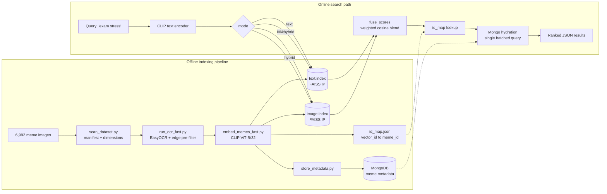

# Meme Search Engine

Semantic meme search over ~7,000 memes. Type `monday morning` or `one does not simply`
and get ranked results back in milliseconds — no tags, no filenames, no keyword matching.

Built on CLIP embeddings and FAISS, served by FastAPI, with a Streamlit UI and a Chrome
extension as clients.

[](https://github.com/SreenityaThatikunta/meme-search/actions/workflows/ci.yml)


## The problem

Memes are hard to search because the joke lives in two places at once: in the picture
and in the caption burned into it. Filename search finds neither. So this project indexes
both, separately, and lets the ranker blend them.

| Mode | What it matches | Wins on |
|---|---|---|
| `text` | CLIP embedding of OCR-extracted caption | "I remember the words" — `one does not simply` |
| `image` | CLIP embedding of the image itself | "I remember the picture" — `surprised cat`, memes with stylised or unreadable text |
| `hybrid` *(default)* | Weighted blend of both cosine scores | General queries, where the two signals disagree and agreement is a useful tiebreaker |

Because CLIP maps text and images into one shared vector space, a *text* query can be
compared directly against *image* embeddings. That is what makes `image` mode work without
the user uploading a picture.

## How it works



Both FAISS indexes are `IndexFlatIP` over L2-normalised 512-d vectors, so inner product
*is* cosine similarity and the two indexes produce scores on the same `[-1, 1]` scale.
That is precisely what makes hybrid fusion a simple weighted sum rather than a
rank-normalisation problem — see [`services/fusion.py`](services/fusion.py).

## Numbers

| | |
|---|---|
| Memes indexed | 6,989 (3 of 6,992 source images were unreadable and skipped) |
| OCR text recovered | 6,987 memes (99.97%), median 12 words |
| Embedding | CLIP ViT-B/32, 512 dimensions |
| Index type | FAISS `IndexFlatIP` — exact search, no recall loss |
| Index size | 13.6 MB per index (two indexes: text + image) |
| Metadata store | MongoDB, unique index on `meme_id` |
| Test suite | 41 tests, runs in ~0.2s without a model or database |

## Quickstart

### 1. Install

```bash
git clone https://github.com/SreenityaThatikunta/meme-search.git
```

```bash
cd meme-search && python -m venv memenv && source memenv/bin/activate
```

```bash
pip install -r requirements.txt
```

### 2. Add the dataset

The meme images are not in the repo (700 MB). Place them in `data/images/images/`.
`data/labels.csv` holds the source dataset's original annotations (filenames, its own
pre-extracted OCR text, sentiment labels); it is kept for provenance and is not read by
the search path — this project runs its own OCR pass instead.

The prebuilt FAISS indexes and `id_map.json` **are** committed, so if you only want to
see search working you can skip step 3 entirely and go straight to loading metadata.

### 3. Build the indexes (optional — prebuilt indexes are committed)

```bash
python scripts/scan_dataset.py && python scripts/run_ocr_fast.py && python scripts/embed_memes_fast.py
```

### 4. Load metadata into MongoDB

```bash
python scripts/store_metadata.py
```

This is idempotent — it upserts on `meme_id`, so re-running it will not duplicate rows.

### 5. Run it

```bash
uvicorn main:app --port 8000
```

```bash
streamlit run app.py
```

The API is at `http://localhost:8000` (interactive docs at `/docs`), the UI at
`http://localhost:8501`. Check `GET /health` to confirm which indexes loaded and which
modes are therefore available.

### Or use Docker

```bash
docker compose up --build
```

Brings up the API and MongoDB together, mounting `./data` read-only rather than baking a
700 MB dataset into the image. You still need to run step 4 against the containerised Mongo.

## API

### `POST /search/text`

```json
{ "query": "exam stress", "top_k": 5, "mode": "hybrid", "text_weight": 0.5 }
```

| Field | Default | Notes |
|---|---|---|
| `query` | required | Natural language query |
| `top_k` | `5` | 1–50 |
| `mode` | `"hybrid"` | `text`, `image` or `hybrid` |
| `text_weight` | `0.5` | Hybrid only: 0.0 ranks on appearance alone, 1.0 on caption alone |

Response:

```json
[
  {
    "meme_id": "meme_000042",
    "image_path": "data/images/images/image_107.jpg",
    "image_url": "http://127.0.0.1:8000/images/image_107.jpg",
    "ocr_text": "me studying the night before the exam",
    "score": 0.2841
  }
]
```

Scores are cosine similarities (or a weighted blend of two), so they are comparable
*within* a result set but are not calibrated probabilities.

### `GET /health`

Reports whether the model loaded, how many vectors each index holds, whether MongoDB is
reachable, and which modes can currently be served. Both clients use it to disable modes
whose index is missing rather than failing at query time.

## Chrome extension

The backend is **not deployed** — it runs on your machine, so the extension needs the
local API running first.

1. Start the API: `uvicorn main:app --port 8000`
2. Open `chrome://extensions/`, enable **Developer mode**
3. **Load unpacked** → select the `meme-extension/` folder
4. Click the toolbar icon, pick a mode, search

## Configuration

Everything is environment-driven with local defaults, so nothing needs editing to run
locally and nothing needs editing to containerise. See [`config.py`](config.py).

| Variable | Default | Purpose |
|---|---|---|
| `MEME_IMAGE_DIR` | `data/images/images` | Images served at `/images` |
| `MEME_TEXT_INDEX` / `MEME_IMAGE_INDEX` | `data/text.index`, `data/image.index` | FAISS indexes |
| `MEME_MONGO_URI` | `mongodb://localhost:27017` | Metadata store |
| `MEME_PUBLIC_BASE_URL` | `http://127.0.0.1:8000` | Base for returned `image_url`s |
| `MEME_DEVICE` | `cpu` | `cpu`, `mps` or `cuda` |
| `MEME_HYBRID_TEXT_WEIGHT` | `0.5` | Default hybrid blend |
| `MEME_CORS_ORIGINS` | `*` | Tighten before exposing the API |

## Tests

```bash
pip install -r requirements-dev.txt && pytest
```

41 tests, ~0.2 seconds, no model download and no database required. The search module
defers its `torch` / `clip` / `faiss` / `pymongo` imports to call time, which lets the
suite substitute fake indexes and an in-memory collection
([`tests/conftest.py`](tests/conftest.py)) and still cover the real ranking, id-mapping,
hydration and HTTP error paths. The same property is why CI finishes in under a minute
without installing PyTorch.

Covered: fusion weighting and tie determinism, all three retrieval modes, `top_k`
capping, FAISS `-1` padding, FAISS/Mongo drift, validation rejections, and the
400/503/500 error contract.

## Known limitations

Worth being straight about these:

- **No retrieval evaluation.** Ranking quality is assessed by eye. There is no labelled
  query set, so there is no Recall@k or MRR to quote. This is the most valuable next step.
- **Exact search won't scale.** `IndexFlatIP` is a brute-force scan — fine and lossless at
  7k vectors, but it is O(n) per query. Past ~1M vectors this needs `IndexIVFFlat` or HNSW,
  which trades a little recall for sublinear search.
- **OCR is the pipeline's weak link.** EasyOCR struggles with heavy stylisation and
  low-contrast captions, and the Canny edge pre-filter that speeds the pass up can skip a
  genuinely text-bearing meme. Errors here propagate silently into the text index.
- **`text_weight` is untuned.** 0.5 is a reasonable prior, not a measured optimum. Tuning
  it needs the eval set above.
- **Single process, in-memory indexes.** The model and both indexes load per worker, so
  horizontal scaling multiplies memory rather than sharing it.
- **Open CORS and no auth.** Fine for `localhost`; both need tightening before this is
  exposed anywhere.

## Roadmap

1. Build a labelled query set and report Recall@k / MRR per mode — then tune `text_weight`
   against it instead of guessing.
2. Swap `IndexFlatIP` for `IndexIVFFlat` and quantify the recall/latency tradeoff.
3. Cache query embeddings; repeat queries currently re-run the text encoder.
4. Accept image queries (upload a meme, find similar) — the image index already supports it.
5. Deploy the API so the extension works without a local server.

## Architecture notes

[`docs/ARCHITECTURE.md`](docs/ARCHITECTURE.md) covers the data model, the two-phase
pipeline, and why each component was chosen over the obvious alternative.

## Project structure

```
meme-search/
├── config.py                   # Env-driven configuration, single source of truth
├── main.py                     # FastAPI app: /search/text, /health
├── app.py                      # Streamlit UI
├── services/
│   ├── search.py               # CLIP encoding, FAISS retrieval, Mongo hydration
│   └── fusion.py               # Hybrid score fusion (dependency-free, unit tested)
├── scripts/
│   ├── scan_dataset.py         # Images → manifest
│   ├── run_ocr_fast.py         # EasyOCR with edge pre-filter, multiprocessed
│   ├── embed_memes_fast.py     # CLIP → both FAISS indexes + id_map
│   └── store_metadata.py       # Idempotent upsert into MongoDB
├── meme-extension/             # Chrome extension (Manifest V3)
├── tests/                      # 41 tests, no model or DB required
├── docs/ARCHITECTURE.md
├── data/                       # Indexes + metadata committed; images are not
├── Dockerfile / docker-compose.yml
└── .github/workflows/ci.yml    # ruff + pytest
```

## Stack

CLIP (ViT-B/32) · FAISS · PyTorch · EasyOCR · FastAPI · Pydantic · MongoDB · Streamlit ·
Chrome Manifest V3 · pytest · ruff · Docker

## License

MIT — see [LICENSE](LICENSE).
