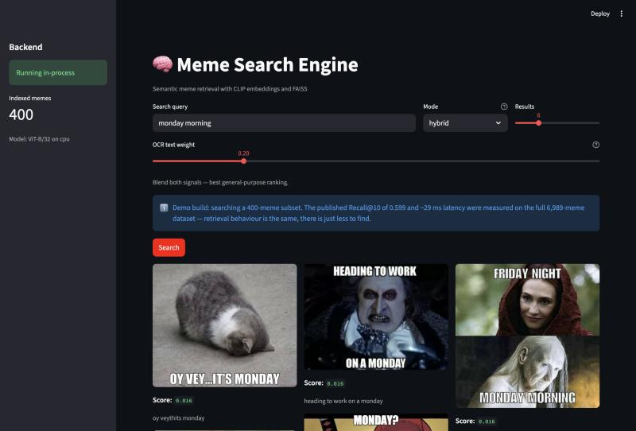

# Meme Search Engine

**Search 7,000 memes by meaning, not filenames — `monday morning` returns the right meme in ~30 ms.**

[](https://github.com/SreenityaThatikunta/meme-search/actions/workflows/ci.yml)


<!-- SCREENSHOT: save a shot or GIF of the Streamlit UI to docs/images/demo.png,
     then uncomment the line below. It's the highest-value thing missing from this page.

-->

Memes are hard to search because the joke lives in two places at once: in the picture and
in the caption burned into it. Filename search finds neither. This indexes both — CLIP
embeddings of the image *and* of its OCR'd text, in two FAISS indexes — and blends the two
rankings at query time.

## Three ways to search

| Mode | What it matches | Wins on |
|---|---|---|
| `text` | CLIP embedding of the OCR-extracted caption | "I remember the words" — `one does not simply` |
| `image` | CLIP embedding of the image itself | "I remember the picture" — `surprised cat`, memes with stylised text |
| `hybrid` *(default)* | Rank fusion of both | General queries, where agreement between the two is a useful tiebreaker |

Because CLIP maps text and images into one shared vector space, a *text* query can be
compared directly against *image* embeddings. That's what makes `image` mode work without
uploading a picture.

## Results

| | |
|---|---|
| Memes indexed | 6,989 · CLIP ViT-B/32 · two 13.6 MB FAISS indexes |
| **Recall@10 / MRR** | **0.599 / 0.407** (1,000 known-item queries) |
| — vs. OCR-text index alone | 0.351 / 0.262 — the original behaviour |
| **Query latency (hybrid)** | **p50 ~29 ms**, of which ~28 ms is CLIP encoding and 0.30 ms is FAISS |
| Test suite | 87 tests, ~0.3 s, no model or database needed |

Switching hybrid fusion from weighted cosine sums to **rank** fusion lifted Recall@10 from
0.397 to 0.599 — CLIP's modality gap makes the two indexes' scores ~3× apart in magnitude,
so a weighted sum is dominated by the text index at almost any weight. That story is the
most interesting thing here: [how it works](docs/OVERVIEW.md#step-4-combine-the-two-rankings--the-part-that-was-wrong-at-first).

Open-ended relevance was also judged by hand (nDCG@5 0.896), but a second annotator agreed
at only **Cohen's kappa 0.140 — poor**, so those figures are indicative and the known-item
numbers above are the ones to trust. Full method, weight sweeps and caveats in
[EVALUATION.md](docs/EVALUATION.md); [LIMITATIONS.md](docs/LIMITATIONS.md) is the honest list.

## Quickstart

```bash
git clone https://github.com/SreenityaThatikunta/meme-search.git && cd meme-search
```

```bash
python3.12 -m venv memenv && source memenv/bin/activate && pip install "setuptools<81" wheel
```

```bash
pip install --no-build-isolation -r requirements.txt
```

<details>
<summary>Why the extra <code>setuptools</code> step</summary>

OpenAI's CLIP package installs from git and its `setup.py` still imports `pkg_resources`,
which setuptools removed in v81. On a fresh Python 3.12+ environment a plain
`pip install -r requirements.txt` fails with
`ModuleNotFoundError: No module named 'pkg_resources'`. Pinning setuptools below 81 and
disabling build isolation makes the install reproducible.
</details>

**Add the dataset.** The images aren't in the repo (700 MB) — place them in
`data/images/images/`. The FAISS indexes and `id_map.json` **are** committed, so you can
skip building them entirely.

**Load metadata and run** (needs MongoDB up; idempotent, upserts on `meme_id`):

```bash
python scripts/pipeline/store_metadata.py
```

```bash
uvicorn main:app --port 8000
```

```bash
streamlit run app.py
```

API at `http://localhost:8000` (interactive docs at `/docs`), UI at
`http://localhost:8501`. `GET /health` reports which indexes loaded and therefore which
modes are available.

<details>
<summary>Rebuilding the indexes from scratch, Docker, and the Chrome extension</summary>

Rebuild the indexes (optional — prebuilt ones are committed):

```bash
python scripts/pipeline/scan_dataset.py && python scripts/pipeline/run_ocr_fast.py && python scripts/pipeline/embed_memes_fast.py
```

Docker brings up the API and MongoDB together, mounting `./data` read-only rather than
baking a 700 MB dataset into the image. You still need to load metadata against the
containerised Mongo:

```bash
docker compose up --build
```

The Chrome extension needs the local API running first — the backend isn't deployed:

1. `uvicorn main:app --port 8000`
2. Open `chrome://extensions/`, enable **Developer mode**
3. **Load unpacked** → select `meme-extension/`
4. Click the toolbar icon, pick a mode, search

</details>

## Reading the code

Read in this order — it's about 400 lines and it's the whole product:

1. [docs/OVERVIEW.md](docs/OVERVIEW.md) — how it works, in plain language, in five minutes
2. [`services/search.py`](services/search.py) — the query path end to end
3. [`services/fusion.py`](services/fusion.py) — the ranking maths, dependency-free

`scripts/eval/` and `services/metrics.py` exist **only** to produce the numbers above.
Skip them unless you care how those were measured.

```
meme-search/
├── config.py              # Env-driven configuration, single source of truth
├── main.py                # FastAPI: POST /search/text, GET /health
├── app.py                 # Streamlit UI
├── services/              # search.py (query path), fusion.py (ranking), metrics.py (eval)
├── scripts/
│   ├── pipeline/          # Builds the product: scan → OCR → embed → store
│   └── eval/              # Produces the numbers only; nothing here runs at query time
├── meme-extension/        # Chrome extension (Manifest V3)
├── tests/                 # 87 tests, no model or DB required
├── docs/                  # See below
└── data/                  # Indexes + metadata committed; images are not
```

Each `scripts/` subfolder has its own README explaining what to run and in what order.

## Docs

| | |
|---|---|
| [OVERVIEW.md](docs/OVERVIEW.md) | How it works, in five minutes — **start here** |
| [ARCHITECTURE.md](docs/ARCHITECTURE.md) | Data model, two-phase design, component choices vs. alternatives |
| [EVALUATION.md](docs/EVALUATION.md) | Method, results, latency, and what the numbers don't show |
| [LIMITATIONS.md](docs/LIMITATIONS.md) | Known limitations and the roadmap, ordered by measured impact |
| [API.md](docs/API.md) | Endpoint reference (or just open `/docs` on the running server) |
| [CONFIGURATION.md](docs/CONFIGURATION.md) | Every environment variable |

## Tests

```bash
pip install -r requirements-dev.txt && pytest
```

87 tests, ~0.3 seconds, no model download and no database. `services/search.py` defers its
`torch` / `clip` / `faiss` / `pymongo` imports to call time, which lets the suite substitute
fake indexes and an in-memory collection ([`tests/conftest.py`](tests/conftest.py)) and
still cover the real ranking, id-mapping, hydration and HTTP error paths. It's also why CI
finishes in under a minute without installing PyTorch.

## License

MIT — see [LICENSE](LICENSE).
