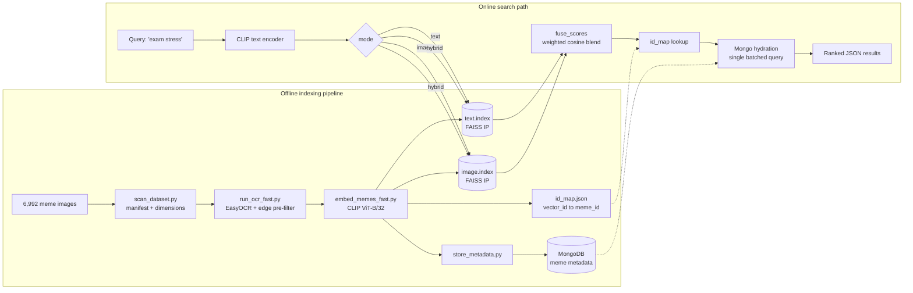

# Meme Search Engine

**Search 7,000 memes by meaning, not filenames — `monday morning` returns the right meme in ~30 ms.**

[](https://github.com/SreenityaThatikunta/meme-search/actions/workflows/ci.yml)


**Stack:** CLIP (ViT-B/32) · FAISS · PyTorch · EasyOCR · FastAPI · MongoDB · Streamlit ·
Chrome Manifest V3 · pytest · ruff · Docker

**Who it's for:** anyone sitting on a folder of thousands of untagged memes (or any image
set with text in it) who wants to find one by describing it. As a reference
implementation, it's for engineers who want a complete, working example of multimodal
retrieval — CLIP embeddings, a vector index, score fusion and a serving layer — small
enough to read end to end in an afternoon.

> **Demo:** no hosted demo — the backend runs locally by design (see
> [Quickstart](#quickstart)). A screenshot/GIF is the one thing still missing from this README.

## The problem

Memes are hard to search because the joke lives in two places at once: in the picture
and in the caption burned into it. Filename search finds neither. So this project indexes
both, separately, and lets the ranker blend them.

| Mode | What it matches | Wins on |
|---|---|---|
| `text` | CLIP embedding of OCR-extracted caption | "I remember the words" — `one does not simply` |
| `image` | CLIP embedding of the image itself | "I remember the picture" — `surprised cat`, memes with stylised or unreadable text |
| `hybrid` *(default)* | Weighted blend of both cosine scores | General queries, where the two signals disagree and agreement is a useful tiebreaker |

Because CLIP maps text and images into one shared vector space, a *text* query can be
compared directly against *image* embeddings. That is what makes `image` mode work without
the user uploading a picture.

## How it works



Both FAISS indexes are `IndexFlatIP` over L2-normalised 512-d vectors, so inner product
*is* cosine similarity. It is tempting to conclude that the two scores are therefore
comparable and can simply be added. **They cannot** — measured on this dataset,
text-to-text cosines average 0.904 while text-to-image cosines average 0.307. The same
nominal `[-1, 1]` range hides a ~3× difference in magnitude, which is CLIP's *modality
gap*, so a weighted sum is dominated by the text index at nearly any weight.

Hybrid fusion therefore combines **ranks, not scores** — weighted Reciprocal Rank Fusion,
which is immune to scale:

```
score(meme) = w / (k + rank_text) + (1 − w) / (k + rank_image)     k = 60
```

That one change lifts Recall@10 from 0.397 to 0.599. The evidence, including the
weighted-sum version it replaced, is in [docs/EVALUATION.md](docs/EVALUATION.md); the
code is [`services/fusion.py`](services/fusion.py).

## Numbers

| | |
|---|---|
| Memes indexed | 6,989 (3 of 6,992 source images were unreadable and skipped) |
| OCR text recovered | 6,987 memes (99.97%), median 12 words |
| Embedding | CLIP ViT-B/32, 512 dimensions |
| Index type | FAISS `IndexFlatIP` — exact search, no recall loss |
| Index size | 13.6 MB per index (two indexes: text + image) |
| Metadata store | MongoDB, unique index on `meme_id` |
| Test suite | 65 tests, runs in ~0.3s without a model or database |
| **Recall@10 / MRR** | **0.599 / 0.407** (1,000 known-item queries) |
| — vs. OCR-text index alone | 0.351 / 0.262 — the original behaviour |
| **Query latency (hybrid)** | **p50 ~29 ms, p95 ~36 ms** |
| — of which FAISS search | 0.30 ms (both indexes, p50) |
| — of which CLIP text encode | ~28 ms (p50) |

Measured on an Apple M2 Pro (10-core, CPU only, `OMP_NUM_THREADS=1`), 50 iterations over
10 distinct queries against the real 6,989-vector indexes — reproduce with
[`docs/benchmark.py`](docs/benchmark.py). Figures are the median of three runs; hybrid p50
ranged 24–30 ms run to run, so treat them as an order of magnitude, not a guarantee.
MongoDB hydration is excluded (it was not running on the benchmark host), so this is the
retrieval path rather than full request time.

**The interesting result:** the vector search is ~1% of the latency. Exact brute-force
FAISS over 6,989 vectors costs 0.30 ms, while encoding the query with CLIP costs ~28 ms —
roughly 95× more. Swapping in an approximate index would optimise the part that is already
free. Caching query embeddings is the only change that would meaningfully move p50, which
is why it outranks `IndexIVFFlat` on the roadmap below.

## Quickstart

Four commands from clone to a running UI, assuming MongoDB is up and the images are in
place (steps 2–3 below).

### 1. Install

```bash
git clone https://github.com/SreenityaThatikunta/meme-search.git && cd meme-search
```

```bash
python3.12 -m venv memenv && source memenv/bin/activate && pip install "setuptools<81" wheel
```

```bash
pip install --no-build-isolation -r requirements.txt
```

> **Why the extra `setuptools` step:** OpenAI's CLIP package is installed from git and its
> `setup.py` still imports `pkg_resources`, which setuptools removed in v81. On a fresh
> Python 3.12+ environment a plain `pip install -r requirements.txt` therefore fails with
> `ModuleNotFoundError: No module named 'pkg_resources'`. Pinning setuptools below 81 and
> disabling build isolation makes the install reproducible.

Optional: copy `.env.example` to `.env` as a reference for the available settings. The app
reads real environment variables, not the file — `export` what you need, or pass them via
`docker compose`.

### 2. Add the dataset

The meme images are not in the repo (700 MB). Place them in `data/images/images/`.
`data/labels.csv` holds the source dataset's original annotations (filenames, its own
pre-extracted OCR text, sentiment labels); it is kept for provenance and is not read by
the search path — this project runs its own OCR pass instead.

The prebuilt FAISS indexes and `id_map.json` **are** committed, so if you only want to
see search working you can skip step 3 entirely and go straight to loading metadata.

### 3. Build the indexes (optional — prebuilt indexes are committed)

```bash
python scripts/scan_dataset.py && python scripts/run_ocr_fast.py && python scripts/embed_memes_fast.py
```

### 4. Load metadata into MongoDB

```bash
python scripts/store_metadata.py
```

This is idempotent — it upserts on `meme_id`, so re-running it will not duplicate rows.

### 5. Run it

```bash
uvicorn main:app --port 8000
```

```bash
streamlit run app.py
```

The API is at `http://localhost:8000` (interactive docs at `/docs`), the UI at
`http://localhost:8501`. Check `GET /health` to confirm which indexes loaded and which
modes are therefore available.

### Or use Docker

```bash
docker compose up --build
```

Brings up the API and MongoDB together, mounting `./data` read-only rather than baking a
700 MB dataset into the image. You still need to run step 4 against the containerised Mongo.

## API

### `POST /search/text`

```json
{ "query": "exam stress", "top_k": 5, "mode": "hybrid", "text_weight": 0.2 }
```

| Field | Default | Notes |
|---|---|---|
| `query` | required | Natural language query |
| `top_k` | `5` | 1–50 |
| `mode` | `"hybrid"` | `text`, `image` or `hybrid` |
| `text_weight` | `0.2` | Hybrid only: 0.0 ranks on appearance alone, 1.0 on caption alone. Default measured, not guessed — see [EVALUATION.md](docs/EVALUATION.md) |

Response:

```json
[
  {
    "meme_id": "meme_000042",
    "image_path": "data/images/images/image_107.jpg",
    "image_url": "http://127.0.0.1:8000/images/image_107.jpg",
    "ocr_text": "me studying the night before the exam",
    "score": 0.2841
  }
]
```

Scores are cosine similarities (or a weighted blend of two), so they are comparable
*within* a result set but are not calibrated probabilities.

### `GET /health`

Reports whether the model loaded, how many vectors each index holds, whether MongoDB is
reachable, and which modes can currently be served. Both clients use it to disable modes
whose index is missing rather than failing at query time.

## Chrome extension

The backend is **not deployed** — it runs on your machine, so the extension needs the
local API running first.

1. Start the API: `uvicorn main:app --port 8000`
2. Open `chrome://extensions/`, enable **Developer mode**
3. **Load unpacked** → select the `meme-extension/` folder
4. Click the toolbar icon, pick a mode, search

## Configuration

Everything is environment-driven with local defaults, so nothing needs editing to run
locally and nothing needs editing to containerise. See [`config.py`](config.py).

| Variable | Default | Purpose |
|---|---|---|
| `MEME_IMAGE_DIR` | `data/images/images` | Images served at `/images` |
| `MEME_TEXT_INDEX` / `MEME_IMAGE_INDEX` | `data/text.index`, `data/image.index` | FAISS indexes |
| `MEME_MONGO_URI` | `mongodb://localhost:27017` | Metadata store |
| `MEME_PUBLIC_BASE_URL` | `http://127.0.0.1:8000` | Base for returned `image_url`s |
| `MEME_DEVICE` | `cpu` | `cpu`, `mps` or `cuda` |
| `MEME_HYBRID_TEXT_WEIGHT` | `0.2` | Default hybrid blend (measured) |
| `MEME_FUSION_STRATEGY` | `rrf` | `rrf` (rank fusion) or `sum` (weighted cosines) |
| `MEME_RRF_K` | `60` | RRF damping constant |
| `MEME_CORS_ORIGINS` | `*` | Tighten before exposing the API |

## Tests

```bash
pip install -r requirements-dev.txt && pytest
```

65 tests, ~0.3 seconds, no model download and no database required. The search module
defers its `torch` / `clip` / `faiss` / `pymongo` imports to call time, which lets the
suite substitute fake indexes and an in-memory collection
([`tests/conftest.py`](tests/conftest.py)) and still cover the real ranking, id-mapping,
hydration and HTTP error paths. The same property is why CI finishes in under a minute
without installing PyTorch.

Covered: both fusion strategies (including the modality-gap case that motivated RRF),
retrieval metric maths, all three modes, `top_k` capping, FAISS `-1` padding, FAISS/Mongo
drift, validation rejections, and the 400/503/500 error contract.

## Known limitations

Worth being straight about these:

- **Evaluation covers known-item retrieval only.** 1,000 queries each have exactly one
  correct answer ("find the meme whose caption went like this"). Open-ended relevance
  ("something relatable about Mondays") is unmeasured, so MRR 0.41 does not mean 41% of
  real searches are good. Eligibility also required a 10-word caption, so memes with
  little or no text are absent from the eval — the very case the image index serves.
- **Exact search won't scale.** `IndexFlatIP` is a brute-force scan — fine and lossless at
  7k vectors (0.30 ms measured), but it is O(n) per query. Past ~1M vectors this needs
  `IndexIVFFlat` or HNSW, which trades a little recall for sublinear search.
- **The CLIP encoder is the latency floor.** ~28 of every 29 ms goes on encoding the query,
  and that cost is fixed per request with no caching in place. Latency is also measured
  on one machine with MongoDB excluded, so it is a retrieval figure, not an SLO.
- **OCR is the pipeline's weak link.** EasyOCR struggles with heavy stylisation and
  low-contrast captions, and the Canny edge pre-filter that speeds the pass up can skip a
  genuinely text-bearing meme. Errors here propagate silently into the text index.
- **`text_weight` is tuned for one task.** 0.2 is optimal for known-item retrieval; an
  open-ended relevance set could prefer another value, and the two are not reconciled.
- **Single process, in-memory indexes.** The model and both indexes load per worker, so
  horizontal scaling multiplies memory rather than sharing it.
- **Open CORS and no auth.** Fine for `localhost`; both need tightening before this is
  exposed anywhere.

## Roadmap

Ordered by measured impact, not by what sounds impressive:

1. **A human-judged relevance set** of open-ended queries, so known-item retrieval and
   general relevance can be tuned against each other rather than one standing in for both.
2. **Cache query embeddings.** The benchmark puts ~99% of latency in the CLIP text
   encoder, so an LRU cache on repeated queries is the single largest available win.
3. **Accept image queries** (upload a meme, find similar) — the image index already
   supports this; it needs only an endpoint and the image preprocessing path.
4. **Deploy the API** so the extension and a demo link work without a local server.
5. **Revisit `IndexIVFFlat`** only past ~1M vectors. At current scale it would trade
   exactness for a speedup on the 0.30 ms leg while leaving the ~28 ms leg untouched.

## Architecture notes

[`docs/ARCHITECTURE.md`](docs/ARCHITECTURE.md) covers the data model, the two-phase
pipeline, and why each component was chosen over the obvious alternative.
[`docs/EVALUATION.md`](docs/EVALUATION.md) has the retrieval numbers, the modality-gap
finding that changed the ranker, and the limits of what was measured.

## Project structure

```
meme-search/
├── config.py                   # Env-driven configuration, single source of truth
├── main.py                     # FastAPI app: /search/text, /health
├── app.py                      # Streamlit UI
├── services/
│   ├── search.py               # CLIP encoding, FAISS retrieval, Mongo hydration
│   ├── fusion.py               # Rank/score fusion (dependency-free, unit tested)
│   └── metrics.py              # Recall@k and MRR (dependency-free, unit tested)
├── scripts/
│   ├── scan_dataset.py         # Images → manifest
│   ├── run_ocr_fast.py         # EasyOCR with edge pre-filter, multiprocessed
│   ├── embed_memes_fast.py     # CLIP → both FAISS indexes + id_map
│   ├── store_metadata.py       # Idempotent upsert into MongoDB
│   ├── build_eval_set.py       # Known-item eval set from human-corrected captions
│   └── evaluate_retrieval.py   # Recall@k / MRR per mode + blend-weight sweep
├── meme-extension/             # Chrome extension (Manifest V3)
├── tests/                      # 65 tests, no model or DB required
├── docs/
│   ├── ARCHITECTURE.md         # Data model, pipeline, design tradeoffs
│   ├── EVALUATION.md           # Method, results, and what they do not show
│   └── benchmark.py            # Reproduces the latency figures above
├── data/                       # Indexes + metadata committed; images are not
├── .env.example                # Every supported setting, with defaults
├── Dockerfile / docker-compose.yml
└── .github/workflows/ci.yml    # ruff + pytest
```

## License

MIT — see [LICENSE](LICENSE).
