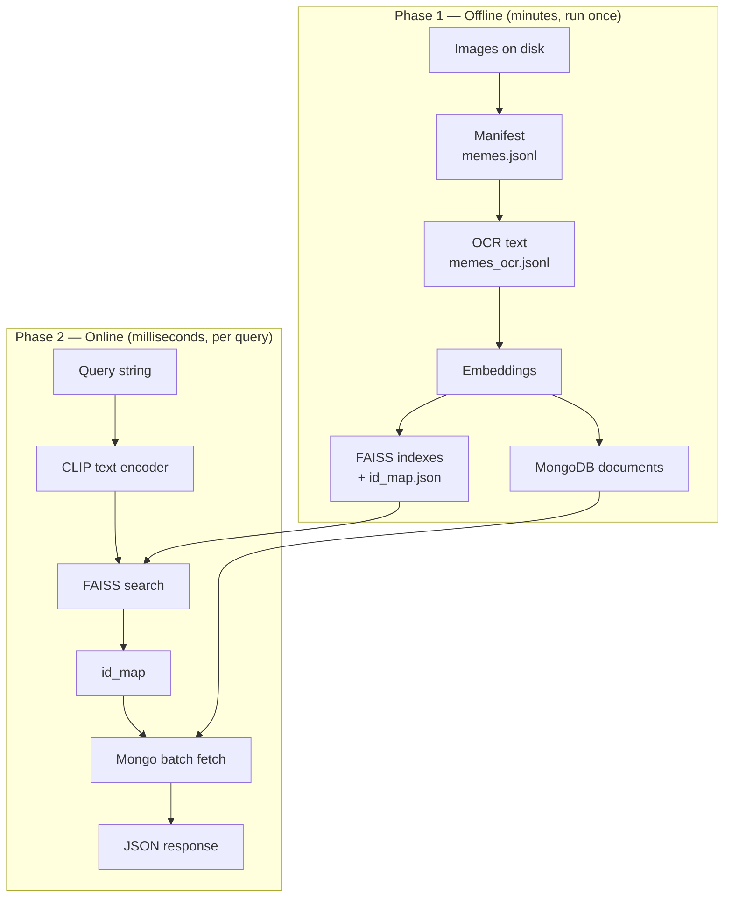
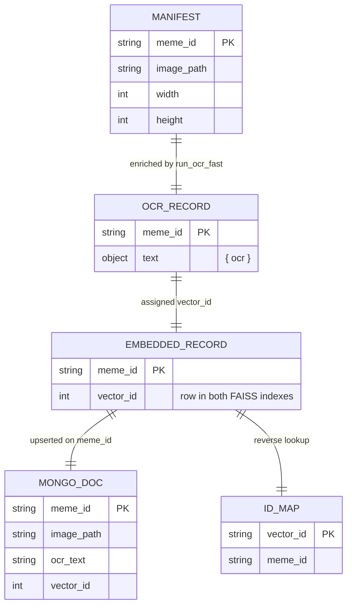
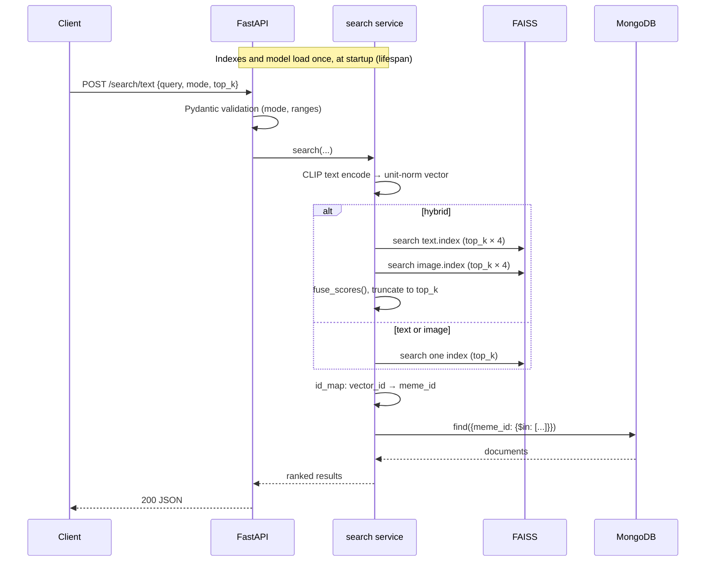

# Architecture

Design notes for the meme search engine: the data model, the two phases, and the
reasoning behind each component choice. For setup and API usage see the
[README](../README.md).

## Two phases

The system splits cleanly into an expensive offline pass and a cheap online one. This is
the central design decision: all the heavy work — OCR, 14,000 forward passes through CLIP
— happens once, so a query at serving time costs one text-encoder pass plus a vector scan.



## Data model

Four artefacts, each with one job. The split exists because vectors and documents have
very different access patterns — vectors are scanned in bulk, documents are fetched by key.



The key invariant: **both FAISS indexes share one `vector_id` space.** Row *i* of
`text.index` and row *i* of `image.index` describe the same meme. That is why a single
`id_map.json` serves both, and why fusing hits from the two indexes is just a dictionary
merge keyed on the resolved `meme_id`.

The matching risk is drift — if the indexes and MongoDB are built from different dataset
snapshots, a `vector_id` can resolve to a `meme_id` that has no document. The search path
treats this as expected rather than exceptional: unresolvable hits are logged and dropped,
so a partially stale index degrades the result set instead of returning a 500.

## Why hybrid retrieval

CLIP's defining property is that text and images land in the *same* 512-d space. A query
embedding can therefore be compared against image embeddings directly — which is why
`image` mode needs no uploaded picture.

Each signal fails in a distinct way:

- The **text index** embeds OCR output. It fails when OCR fails: stylised fonts,
  low contrast, text baked into busy artwork.
- The **image index** embeds pixels. It fails when the joke is purely linguistic — two
  visually identical templates carrying opposite captions are near-identical vectors.

Since both indexes are `IndexFlatIP` over L2-normalised vectors, inner product equals
cosine similarity, and both produce scores on the same `[-1, 1]` scale. Fusion is then an
honest weighted sum rather than a rank-normalisation exercise:

```
fused(meme) = w · cos(query, ocr_text_emb) + (1 - w) · cos(query, image_emb)
```

A meme found by only one index keeps that index's weighted contribution and no more, so
memes both views agree on rise naturally — agreement acts as a tiebreaker without any
special-casing. Each index is oversampled (`HYBRID_OVERSAMPLE`, default 4×) before fusion
so re-ranking has candidates to work with rather than being constrained to each index's
own top-k.

## Component choices

**CLIP ViT-B/32 over a sentence embedding model.** A text-only embedder would force every
meme through OCR and discard the picture entirely — fatal for image macros whose text is
unreadable. CLIP's shared space is what makes one query serve two indexes. ViT-B/32 over
larger variants because 512-d vectors at 7k scale keep each index at 13.6 MB and inference
viable on CPU.

**FAISS `IndexFlatIP` over an approximate index.** At 6,989 vectors a brute-force scan is
sub-millisecond and *exact* — zero recall loss. Reaching for IVF or HNSW here would add
tuning parameters and recall error to buy a speedup that is not needed. The honest framing
is that this is the right choice at this scale and the wrong one past ~1M vectors.

**FAISS plus MongoDB rather than one vector database.** FAISS stores vectors and returns
integer row ids; it has no concept of a payload. Something has to turn row 4,213 into a
file path and a caption. Keeping that in MongoDB means metadata can be re-loaded or
corrected without rebuilding embeddings, and rebuilt embeddings don't disturb metadata.
The cost is the drift risk described above.

**Deferred heavy imports.** `services/search.py` imports torch, clip, faiss and pymongo
*inside* `load_resources()` rather than at module scope. This is what lets `main.py` and
the test suite be imported without a 350 MB model present, and it is why CI runs the full
suite in seconds on `requirements-dev.txt` alone. The ranking logic lives in
`services/fusion.py` with no third-party dependencies at all, so the maths is unit-testable
in isolation.

**Batched metadata hydration.** Results are hydrated with a single `$in` query rather than
one `find_one` per hit — `top_k` round trips collapse to one.

## Request lifecycle



Failure modes map onto distinct status codes: an unavailable mode or bad argument is a
`400`, a missing index file is a `503` (the service is misconfigured, not the request),
and anything unexpected is a `500` with the detail logged server-side rather than returned
to the caller.

## What this architecture does not do

See **Known limitations** in the [README](../README.md#known-limitations) — chiefly that
there is no retrieval evaluation, so `text_weight = 0.5` is a reasoned prior rather than a
measured optimum.
